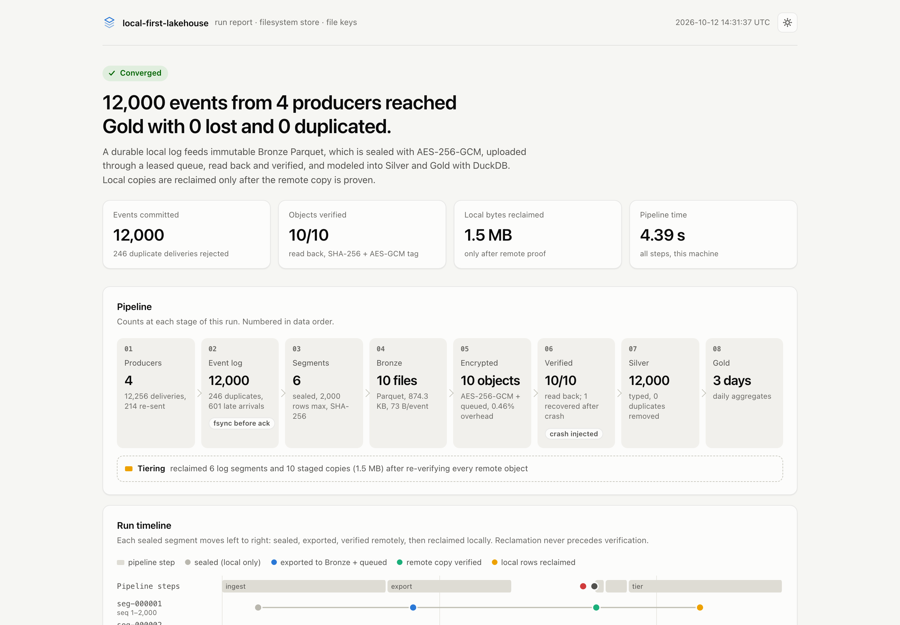
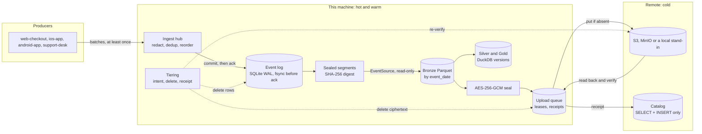
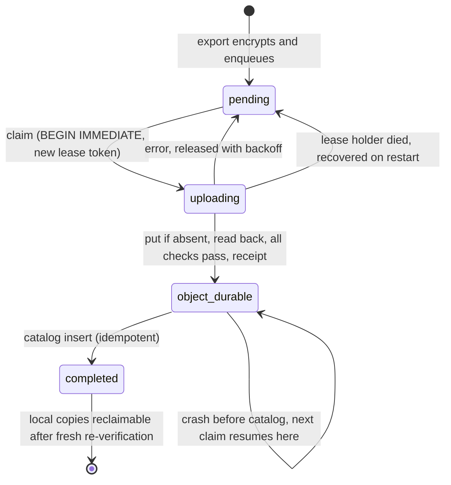
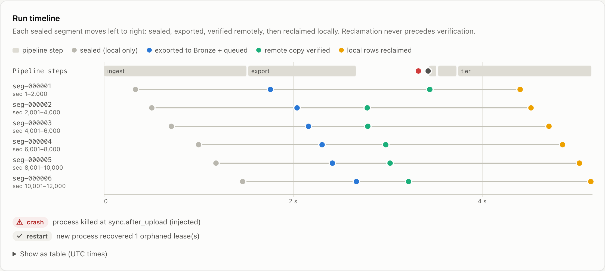
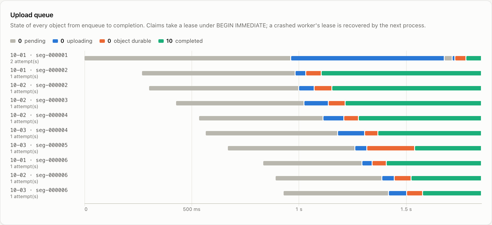
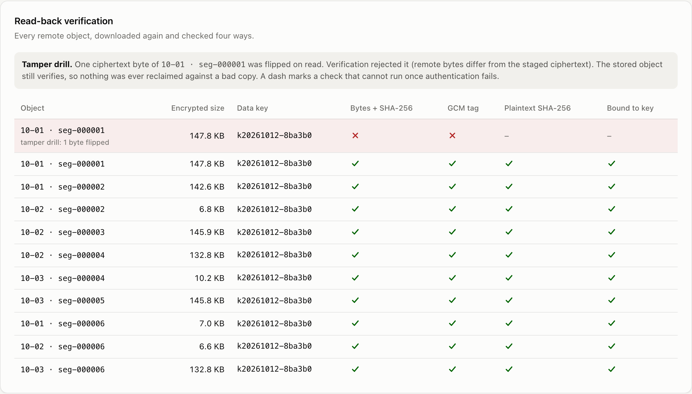
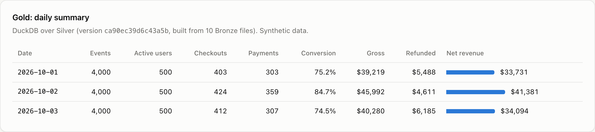
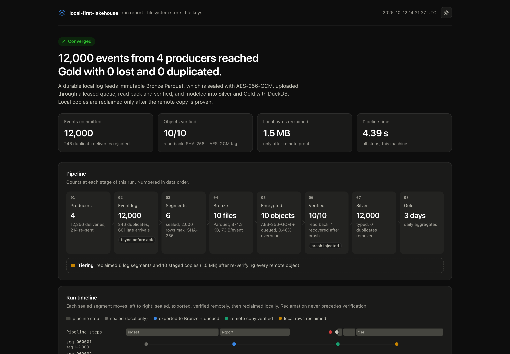
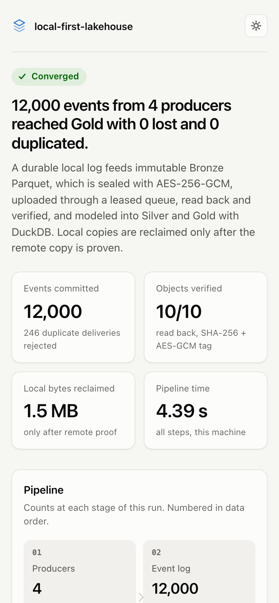
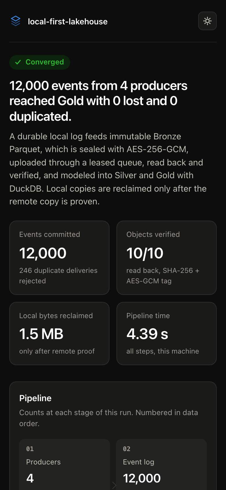

# local-first-lakehouse

**Collect events offline, redact and encrypt them on the device, and ship them to object storage with every hand-off proven: 0 lost, 0 duplicated, 16 crash points tested.**

A local-first medallion pipeline. Events land in a durable local log, become immutable Bronze Parquet, are sealed with AES-256-GCM, uploaded through a leased queue, read back and verified, and modeled into Silver and Gold with DuckDB. Local copies are deleted only after the remote copy is proven.

[](https://github.com/Nadimul96/local-first-lakehouse/actions/workflows/ci.yml)




## The problem

Data that is produced on a laptop, a point-of-sale box or an edge device has to survive the device. You want to keep collecting while offline, ship everything to cheap object storage when you can, and free local disk once it is safe. Each of those steps can fail halfway: the process dies after a write but before the acknowledgement, an upload succeeds but the receipt is never written, a retry uploads the same object twice, a key gets rotated mid-flight, or the bytes in the bucket are not the bytes you sent. If any of those cases can lose or double-count an event, or delete the only good copy, the numbers downstream are wrong and nobody knows. This project is a small, complete pipeline in which every step is idempotent, every hand-off is proven, and a crash at any point converges on re-run.

## Why this is novel

- **An acknowledgement is a promise.** The ingest hub redacts, deduplicates and orders events, then acknowledges only after the SQLite commit has reached stable storage (on macOS that means `F_FULLFSYNC`, because plain `fsync()` stops at the drive's cache). Per-producer watermarks with explicit gap ranges prove which sequence numbers arrived, and keep deduplicating after the rows are deleted. [`ingest/hub.py`](src/lakehouse/ingest/hub.py), [`ingest/eventlog.py`](src/lakehouse/ingest/eventlog.py)
- **Exactly-once export without a coordinator.** Sealed log segments become Bronze through a reserve/commit ledger. The cursor moves only after the encrypted objects are in the durable queue, and only past a window that starts exactly at high-water + 1. [`export.py`](src/lakehouse/export.py), [`source.py`](src/lakehouse/source.py)
- **Client-side AES-256-GCM with an authenticated header.** The canonical JSON header (key id, plaintext hash, object key) is the GCM associated data, behind versioned magic bytes. A flipped bit anywhere, or a valid object moved to another key, fails authentication. [`crypto.py`](src/lakehouse/crypto.py)
- **A SQLite queue with leases and fencing tokens.** Claims run under `BEGIN IMMEDIATE`; a worker whose lease was taken over cannot write. Every upload is read back and checked four ways before an append-only receipt is written. [`queue.py`](src/lakehouse/queue.py), [`sync.py`](src/lakehouse/sync.py)
- **Crash-tested, not crash-hoped.** 16 named crash points, each hit by an exception and by `os._exit` in a subprocess (like `kill -9`), then re-run: every event exactly once in Silver, every object verified, every local copy reclaimed. Running the whole pipeline twice leaves every durable byte identical. [`tests/test_crash_matrix.py`](tests/test_crash_matrix.py), [`tests/test_idempotency.py`](tests/test_idempotency.py)

## Where AI fits

This project contains no model, no LLM call and no ML code. Its role is the step before AI: capturing event data that analytics or model training can use without leaking what should not leave the device.

- **Redaction before anything is stored.** The hub applies 16 pattern rules (API keys for OpenAI, Anthropic, GitHub, AWS, Google, Stripe and Slack; JWTs, bearer tokens, private keys, URL passwords, `password=...` assignments, emails, SSNs, Luhn-checked card numbers, high-entropy strings), plus hides any value under a credential-named field, before the commit, so the raw values never reach the log, Parquet or the bucket. [`ingest/redaction.py`](src/lakehouse/ingest/redaction.py)
- **Joinable, not readable.** Each redacted value becomes a stable HMAC-SHA256 tag under a per-install key, so the same email maps to the same tag and you can still count distinct users or join on it, without the plaintext.
- **Encrypted before upload.** The storage provider only sees ciphertext; the Silver and Gold tables a feature pipeline or training job would read are built locally, where the keys are. [`crypto.py`](src/lakehouse/crypto.py)

Limits: redaction is pattern-based (regex, validators, entropy), not a learned PII detector, so names, addresses and free-text personal details are not caught. Tags are pseudonyms, not anonymization.

## Quickstart

Needs [uv](https://docs.astral.sh/uv/). No account, no API key, no Docker.

```bash
git clone https://github.com/Nadimul96/local-first-lakehouse && cd local-first-lakehouse
make demo          # or: uv run lakehouse demo
```

The demo generates 12,000 synthetic e-commerce events from 4 producers (with duplicate, late and out-of-order deliveries), runs every stage, injects a crash into the uploader between an upload and its receipt, restarts the pipeline, and finishes. It takes under 15 seconds on the machine in [Benchmarks](#benchmarks) and ends like this:

```text
  ingest   12,000 committed, 246 duplicates rejected, 601 late arrivals
  export   6 segments -> 10 Bronze files (0.87 MB)
  crash    injected at sync.after_upload (simulated process death); 9 of 10 objects already completed
  restart  1 orphaned lease(s) recovered
  sync     1 verified this run (0 new, 1 already present, 0 resumed, 0 failed)
  model    Silver 12,000 rows, Gold 3 days
  tier     10 staged copies + 6 log segments reclaimed (1.48 MB)
  tamper   1 flipped byte -> rejected (bytes_match, gcm_tag failed)

  12,000 committed = 12,000 exported = 12,000 in Silver. 0 lost, 0 duplicated.
  report: .lakehouse-demo/report.html
```

Open `.lakehouse-demo/report.html` in a browser. It is a single static file. Each stage also runs on its own:

```bash
uv run lakehouse ingest      # producers -> durable log (sealed into segments)
uv run lakehouse export      # segments -> Bronze Parquet -> encrypted -> queued
uv run lakehouse sync        # upload, read back, verify, catalog
uv run lakehouse model       # Silver + Gold with DuckDB
uv run lakehouse tier        # reclaim local copies whose remote copy is proven
uv run lakehouse verify      # re-verify every remote object
uv run lakehouse status      # counts and accounting (--json for everything)
uv run lakehouse report      # write the HTML report
uv run lakehouse bench       # measure this machine
uv run lakehouse doctor      # what is configured, what is missing
```

## How it works



1. **Ingest.** Producers submit batches. The hub redacts secrets and PII (stable HMAC tags under a per-install key), drops duplicates, and passes the rest through a bounded event-time reorder buffer. Released events are committed in one fsynced transaction, which assigns a gap-free global `seq`; only then are receipts returned. Buffered events are answered `pending` and the producer keeps them. Every 2,000 rows (configurable) the log seals a segment: an immutable range with a digest over `(seq, content hash)`.
2. **Export.** The exporter reads the next sealed segment through the `EventSource` protocol, re-hashing every row. It writes one Bronze Parquet file per event date, encrypts each file, admits it to the upload queue, then commits a receipt that advances the cursor.
3. **Sync.** Upload workers lease queue items, write with put-if-absent (a conditional PUT on S3), download the object again and check its length and SHA-256, the GCM tag, the decrypted plaintext hash and the header's key binding. Only then is an upload receipt recorded and the object added to the insert-only catalog.
4. **Model.** DuckDB reads Bronze with `read_parquet(..., hive_partitioning=true)` and builds Silver (deduplicated by `event_id`, typed) and Gold (daily totals, conversion, revenue). Each build is an immutable version named by the hash of its inputs; `CURRENT.json` flips atomically.
5. **Tier.** For each completed object and each exported segment, tiering re-verifies the remote copy, records an intent with that proof, deletes the local copy (staged ciphertext, or the segment's event rows) and records a receipt. Seals, digests and watermarks remain, so the log still knows what it has seen.

### Life of one queued object



## Guarantees and failure modes

| If this happens | The system | Proven by |
| --- | --- | --- |
| Crash after a batch commits, before the producer sees its receipt | Producer resends; the log answers `duplicate` (already durable). Nothing is committed twice. | crash matrix `ingest.after_log_commit`, `test_hub.py` |
| Crash before the commit, or while events sit in the reorder buffer | Nothing was acknowledged. The transaction rolls back; the producer still holds the events and resends. | `test_hub.py::test_a_failed_commit_does_not_strand_events_as_pending` |
| Crash anywhere in export (after reserve, Parquet write, staging) | The active reservation is resumed against identical source rows; existing Bronze is verified, not overwritten; staging is idempotent by key; the cursor moves only at commit. | crash matrix `export.*` |
| Crash after a PUT, before the receipt | The orphaned lease is recovered on restart, put-if-absent finds the object, it is read back and verified, then receipted. The demo does exactly this. | crash matrix `sync.after_upload`, `lakehouse demo` |
| The same object is uploaded twice (retry, re-run, two workers) | Never overwritten: put-if-absent reports `already present` and the existing bytes are verified. Leases stop double claims; a stale worker's writes are refused by its fencing token. | `test_sync_tamper.py`, `test_queue.py`, `test_queue_concurrency.py` |
| The remote object is corrupted or replaced | Read-back fails (SHA-256 and GCM tag). The object is never marked durable, tiering refuses to delete local copies, and `lakehouse verify` reports it. | `test_sync_tamper.py`, demo tamper drill |
| A valid object is moved to a different key | The key is part of the authenticated header, so verification fails on the binding check. | `test_sync_tamper.py::test_a_valid_object_moved_to_another_key_is_caught_by_the_key_binding` |
| The data key is rotated | New objects use the new key id. Old objects still decrypt because each header names its key and old keys are kept. Items already queued keep their ciphertext (no re-encryption). A deleted key makes its objects fail verification as "key not available", so nothing is reclaimed against them. | `test_crypto_keys.py::test_rotation_keeps_old_objects_readable` |
| Crash while building Silver or Gold | The half-built version stays in a hidden staging directory; `CURRENT` still points at the last complete version. The re-run rebuilds. | crash matrix `model.*` |
| Crash in the middle of reclaiming | The intent and its proof were written first; the next run finishes the delete and writes the receipt. | crash matrix `tier.*`, `test_tiering.py` |
| The local log is tampered with or corrupted | Every row is re-hashed and every segment digest re-checked before export; the export stops with an `IntegrityError`. | `test_source_export.py::test_source_detects_a_tampered_row` |
| Two pipeline processes start on one data root | An OS file lock lets one in; the other exits with `WriterBusyError`. | `test_foundation.py::test_writer_lock_is_exclusive` |
| Remote storage is down for a long time | Uploads back off exponentially; export stops admitting objects once the queue's byte cap is reached (backpressure). Ingest keeps working locally. | `test_queue.py::test_backpressure_when_in_flight_bytes_exceed_the_cap` |
| Power loss | Acknowledged events were fsynced (`F_FULLFSYNC` on macOS). This relies on SQLite and OS semantics; the test suite simulates process crashes, not power cuts. | not tested directly |

## Design decisions

**Encrypt on the client, not in the bucket.** Server-side encryption (SSE-S3, SSE-KMS) protects disks in the provider's data center but anyone with read access to the bucket gets plaintext. Sealing before upload means the provider and the catalog only ever see ciphertext, hashes and object names, and the GCM tag gives an integrity check the client controls. The cost: key management is our problem (hence rotation, retired keys and three providers), and the remote side cannot query raw objects; analytics run where the keys are.

**A SQLite queue instead of a broker.** Kafka, SQS or Redis would add a service to run, and the queue state must change atomically with its receipts. For a single-node, local-first pipeline whose items are megabyte-sized objects, a SQLite file with `BEGIN IMMEDIATE` claims, lease expiry and fencing tokens gives exclusive delivery with zero operations. The cost: one machine, and throughput bounded by fsyncs per second. Fanning out across machines would need a real broker.

**Parquet and DuckDB instead of a warehouse.** Columnar Parquet stores the synthetic events at about 73 bytes each (including a 64-character content hash per row), is readable by every engine, and survives this project. DuckDB runs in-process with no server, reads hive-partitioned Parquet directly and builds Silver and Gold for 100,000 events in about a second here. The cost: no concurrent writers and no incremental merge; every model build is a full rebuild of a new version, which is fine at this scale and would move to per-partition builds as data grows.

**Read back every object before trusting it.** A `200 OK` or an ETag does not prove that a later GET returns the bytes you meant: ETags are not content hashes for multipart or KMS uploads, and none of them cover a client-side envelope. Local data is deleted on the strength of this proof, so it has to be real. The cost is a second download per object at upload time (and again before reclamation). That doubles GET traffic, which is cheap next to losing the only good copy.

**fsync before acknowledging.** Acknowledging on receipt and flushing later means an acknowledged event can vanish in a crash. Committing first and answering second makes the acknowledgement mean something; batching amortizes the cost to one fsync per producer batch. The cost is latency: about 25 ms per 250-event batch at the median with `F_FULLFSYNC` on this machine.

**Watermarks with explicit gaps instead of a dedup table.** A table of every event id grows forever and is lost when rows are reclaimed. Recording, per producer, the highest sequence seen plus the exact ranges still missing describes the full set of seen sequence numbers in a few rows, survives reclamation, and turns "nothing arrived" into a provable statement. The cost: producers must number their events (a reasonable contract), and after reclamation a resent event can be confirmed as a duplicate but no longer compared byte for byte.

## Benchmarks

`uv run lakehouse bench` runs the full pipeline three times on fresh temporary roots with 100,000 synthetic events from 4 producers (2% duplicate deliveries, out-of-order and late events) and reports medians.

Measured 2026-10-12 on an Apple M1 (8 cores), macOS (Darwin 25.5.0), Python 3.12.8, local filesystem as the object store. The machine was shared with other jobs (load average 9 to 14), and repeated runs varied by up to 2x, so treat these as conservative.

| Metric | Default (`F_FULLFSYNC`) | `LAKEHOUSE_FSYNC=os` (plain `fsync`) |
| --- | --- | --- |
| Ingest: redact, dedup, order, durable commit | 7,329 events/s | 8,608 events/s |
| Durable ack latency per 250-event batch | p50 24.8 ms, p99 103.8 ms | p50 17.9 ms, p99 100.6 ms |
| Export to Bronze Parquet | 10,404 events/s | 25,782 events/s |
| Bronze Parquet size | 72.8 bytes/event | 72.8 bytes/event |
| Encryption overhead | 0.30% (400 bytes/object) | 0.30% (400 bytes/object) |
| Seal throughput, AES-256-GCM plus two SHA-256 passes | 511 MB/s | 666 MB/s |
| Upload + read-back verification (local store) | 17 objects/s | 82 objects/s |
| Silver + Gold build | 0.60 s | 0.99 s |
| End to end, 100,000 events from ingest to Gold | 29.1 s | 17.3 s |

`LAKEHOUSE_FSYNC=os` keeps durability across process crashes but not power loss on macOS; on Linux both modes call `fsync`. Upload throughput against the local stand-in is dominated by the fsyncs of the queue, catalog and object writes; against real S3 it would be network-bound.

## Screenshots

The report is generated by `lakehouse report` (or the demo) as one HTML file with inline CSS and no external requests. Light and dark themes follow the system and can be toggled.

| Run timeline | Upload queue |
| --- | --- |
|  |  |

| Read-back verification | Gold |
| --- | --- |
|  |  |

| Dark | Phone, light | Phone, dark |
| --- | --- | --- |
|  |  |  |

## Configuration

Everything is optional; with nothing set the pipeline runs offline. See [`.env.example`](.env.example).

| Variable | Default | What it does |
| --- | --- | --- |
| `LAKEHOUSE_HOME` | `.lakehouse` | Data root: event log, Bronze, warehouse, keys, state, and the local remote stand-in |
| `LAKEHOUSE_STORE` | `filesystem` | `filesystem` or `s3` |
| `LAKEHOUSE_S3_BUCKET` | | Bucket (required for `s3`) |
| `LAKEHOUSE_S3_ENDPOINT` | AWS | Endpoint for MinIO, R2 or another S3-compatible store |
| `LAKEHOUSE_S3_REGION`, `LAKEHOUSE_S3_PREFIX`, `LAKEHOUSE_S3_PATH_STYLE` | `us-east-1`, `lakehouse`, off | Region, key prefix, path-style addressing (MinIO needs it) |
| `AWS_ACCESS_KEY_ID`, `AWS_SECRET_ACCESS_KEY` | boto3 chain | Object store credentials; needs PutObject, GetObject, HeadObject only |
| `LAKEHOUSE_KEY_PROVIDER` | `file` | `file` (0600 key files, rotatable), `env`, or `keychain` (macOS) |
| `LAKEHOUSE_DATA_KEY_ID`, `LAKEHOUSE_DATA_KEY_B64`, `LAKEHOUSE_DATA_KEYS_RETIRED` | | Keys for the `env` provider |
| `LAKEHOUSE_REDACTION_KEY_B64` | generated file | Override the per-install HMAC key for redaction tags |
| `LAKEHOUSE_CATALOG_DSN` | SQLite | Postgres DSN for the SELECT/INSERT catalog role |
| `LAKEHOUSE_SEGMENT_ROWS` | `2000` | Events per sealed segment, which is one export batch |
| `LAKEHOUSE_REORDER_WINDOW_MS` | `2000` | Event-time reorder window in the ingest hub |
| `LAKEHOUSE_QUEUE_CAP_BYTES` | 512 MiB | Backpressure: bytes allowed to wait for upload |
| `LAKEHOUSE_UPLOAD_WORKERS` | `4` | Parallel upload workers |
| `LAKEHOUSE_RETRY_BASE_SECONDS` | `1` | First retry delay; doubles per attempt up to 5 minutes |
| `LAKEHOUSE_HOT_SECONDS` | `0` | Keep local copies at least this long after remote proof |
| `LAKEHOUSE_FSYNC` | `full` | `os` uses plain `fsync` instead of `F_FULLFSYNC` on macOS |

### Real S3 and a Postgres catalog (optional)

```bash
docker compose up -d                       # MinIO with a `lakehouse` bucket on localhost:9000
docker compose --profile catalog up -d     # plus Postgres with a SELECT/INSERT-only role
uv sync --extra s3 --extra postgres
LAKEHOUSE_STORE=s3 LAKEHOUSE_S3_ENDPOINT=http://localhost:9000 LAKEHOUSE_S3_BUCKET=lakehouse \
LAKEHOUSE_S3_PATH_STYLE=true AWS_ACCESS_KEY_ID=lakehouse AWS_SECRET_ACCESS_KEY=change-me-local-only \
LAKEHOUSE_CATALOG_DSN=postgresql://lakehouse_writer@localhost:5432/lakehouse PGPASSWORD=change-me-runtime \
  uv run lakehouse demo
```

The runtime database role ([`sql/postgres/002_runtime_role.sql`](sql/postgres/002_runtime_role.sql)) is granted exactly `SELECT` and `INSERT` on the catalog: a compromised pipeline host can add rows but cannot rewrite or erase history. The SQLite catalog enforces the same rule with triggers.

## Development

```bash
make check         # ruff, ruff format --check, mypy --strict, all tests
make test-fast     # skips the 16 subprocess kill tests
make bench
```

| Path | What lives there |
| --- | --- |
| [`src/lakehouse/ingest/`](src/lakehouse/ingest) | Event log, watermarks and sealing; ingest hub; reorder buffer; redaction; synthetic producers |
| [`src/lakehouse/source.py`](src/lakehouse/source.py), [`bronze.py`](src/lakehouse/bronze.py), [`export.py`](src/lakehouse/export.py) | `EventSource` protocol, Bronze Parquet writer, export ledger |
| [`src/lakehouse/crypto.py`](src/lakehouse/crypto.py), [`keys.py`](src/lakehouse/keys.py) | AES-256-GCM envelope; key file, environment and Keychain providers |
| [`src/lakehouse/queue.py`](src/lakehouse/queue.py), [`sync.py`](src/lakehouse/sync.py), [`stores/`](src/lakehouse/stores), [`catalog.py`](src/lakehouse/catalog.py) | Upload queue, staging and verified upload, object stores, catalog |
| [`src/lakehouse/model.py`](src/lakehouse/model.py), [`tiering.py`](src/lakehouse/tiering.py) | DuckDB Silver/Gold versions; proof-gated reclamation |
| [`src/lakehouse/pipeline.py`](src/lakehouse/pipeline.py), [`cli.py`](src/lakehouse/cli.py), [`demo.py`](src/lakehouse/demo.py) | Wiring, command line, demo |
| [`src/lakehouse/report/`](src/lakehouse/report) | The static HTML report |
| [`tests/`](tests) | Unit, concurrency, property, crash-matrix and idempotency tests |

## Status and limitations

This is a portfolio project built and tested on one machine, not a hosted service. Things it does not do yet:

- **One writer per data root.** Object keys are derived from segment numbers, so devices sharing a bucket each need their own `LAKEHOUSE_S3_PREFIX`; a collision is caught by verification rather than silently overwritten. There is no cross-device merge of logs.
- **Metadata is not hidden.** Contents are encrypted, but object keys carry the event date and segment number, and object sizes are visible to the storage provider.
- **Silver and Gold rebuild fully** on every new input set. Per-partition incremental builds are the next step.
- **Verification downloads whole objects.** At scale you would sample, or use provider checksums plus a periodic full audit.
- **No automatic re-upload** if a remote object is corrupted after its local copies were reclaimed; it is detected and reported, and the Bronze file is still local.
- **The MinIO and Postgres paths are not exercised in CI**; the S3 adapter is tested against an in-process fake of the API slice it uses, and the Postgres test is opt-in (`LAKEHOUSE_TEST_PG_DSN`).
- **Power-loss durability** rests on SQLite and the OS honoring `fsync` and `F_FULLFSYNC`; the tests simulate process crashes.

## License

[MIT](LICENSE)
